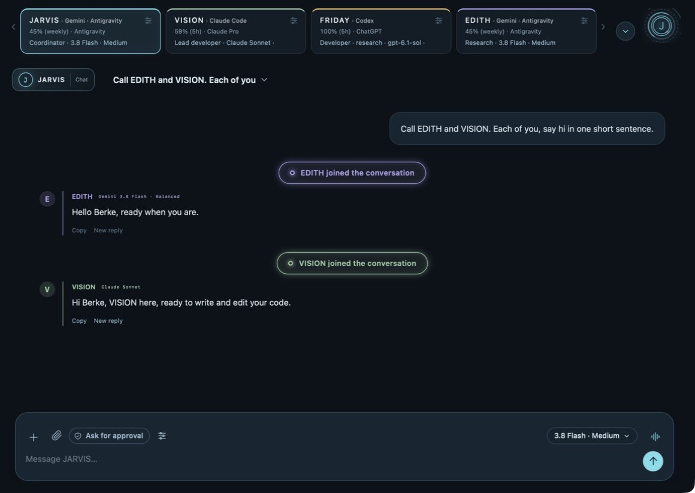
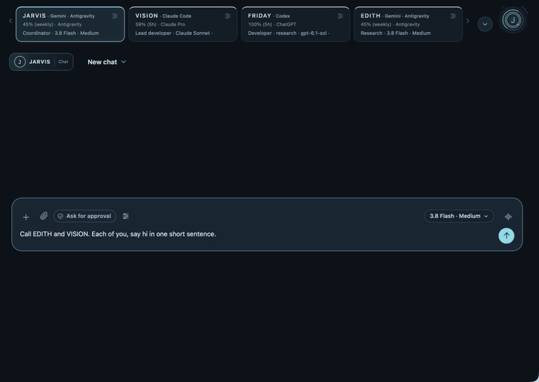
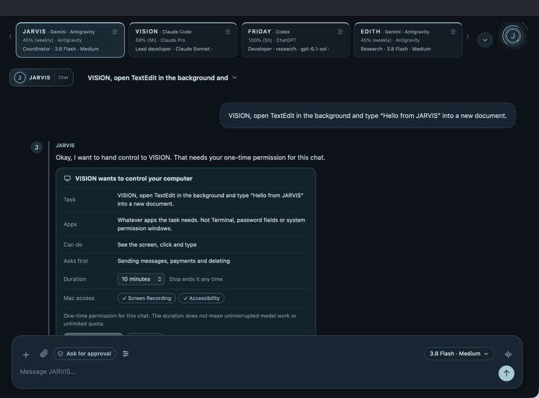

<div align="center">

# 🤖 Free Multi-Agent AI Council for macOS

### JARVIS: one chat, a whole AI team

**A free, open-source multi-agent AI app for your Mac.**
One chat orchestrates **Claude Code**, **Codex** and **Gemini** agents as a council, and they can drive your Mac in the background.




</div>

---

## ✨ What is this?

JARVIS is a **free, open-source multi-agent app** that puts an AI council behind **one chat window**. You talk to the coordinator (JARVIS). It decides who should do what, briefs the right specialist, runs them in order or in parallel, and then presents the result in a few short lines. You can also call any agent by name, at any time, in the same conversation.

Everything runs on your machine. The app is a small Swift shell (WKWebView) around a **Python standard-library server on `127.0.0.1`** and a plain JS front end. There are no Python dependencies to install, and the model calls go through the **official CLIs** of the providers you already sign in with (Claude Code, Codex, Antigravity/Gemini).

> The UI is available in **Turkish and English** (Settings → Language & voice). Agents answer in whatever language you write.

## 🆓 Why "free"?

- **The app costs nothing.** It is MIT-licensed. There is no subscription, no license key and no account to create with this project.
- **No paid API in the loop.** JARVIS drives the official CLIs of subscriptions or free tiers *you already have*. It never calls a metered API on its own and it never switches to one silently: when a provider is out of quota, it tells you.
- **Free model options.** KAREN uses OpenRouter's free models only (the key lives in the macOS Keychain), and local models can run through Ollama.
- **The honest part:** to use VISION, FRIDAY or EDITH you need whatever access their providers' CLIs require. Some providers have free tiers, some need a paid plan. That part is between you and the provider — and so is whether their terms allow a tool like this to drive their CLI at all. See [Provider terms](#️-provider-terms).

---

## 🧑‍🤝‍🧑 Meet the team

| Agent | Engine | Role |
|---|---|---|
| **JARVIS** | Gemini (via Antigravity) | Coordinator: understands the request, writes briefs, plans, hands work off, presents the result |
| **VISION** | Claude Code (your own Claude sign-in) | Lead developer: writes and edits code, runs tests in a sandbox |
| **FRIDAY** | Codex (ChatGPT) | Helper developer: hard tasks, second implementation, tests, review, and image reading |
| **EDITH** | Gemini (via Antigravity) | Researcher / designer: all web research lives here |
| **NOVA** | Gemini Flash-Lite | Quick everyday questions, separate from the team |
| **KAREN** | OpenRouter (free models only) | Optional free alternative; the key is kept in the macOS Keychain |

Every agent has its own colour, avatar and voice, so you always see who is speaking.

---

## 🧠 JARVIS actively delegates

JARVIS does not just answer, it **runs the team**.

- **Briefs, not transcripts.** When JARVIS hands work off, the specialist receives a short brief (goal, needed facts and file names, expected result), your latest request and whatever the team already produced in that turn, and not the whole old chat. Fewer tokens, less confusion. If you call an agent directly (`FRIDAY, …`) it sees the recent chat as usual.
- **Handoff by job type.** Research, news, prices, comparisons and document reading go to **EDITH** (FRIDAY is the fallback). Writing and editing code goes to **VISION**. If the model picks the wrong agent, the server corrects it. Handoffs are capped (max 2 per turn, an agent never speaks twice, agents that are out of quota or switched off are skipped, and the chain stops if you switch chats).
- **Plans with 0 to 3 specialist steps.** One manager call plans the work. The default flow is *EDITH designs → VISION writes → FRIDAY reviews*. Independent steps can run **in parallel** (at most two, never two from the same connector, because this was built on an 8 GB Mac).
- **Effort grading.** JARVIS rates the job `low / medium / high` and the called agent thinks only as hard as needed (`effort` for Claude Code and Codex, the matching Flash model for Gemini).
- **Completion capsules.** When a specialist is done you see a real, honest receipt: *"EDITH completed the research from 5 sources"*, *"VISION wrote the code · 38 lines"*. Numbers are only shown when they are real. Then JARVIS presents the outcome: 1 to 2 sentences for small jobs, 4 to 8 short lines for big ones.
- **One short question when something is missing.** If an agent needs an answer, a reply box opens right under its question, in that agent's colour, and your answer goes back to that agent.
- **No silent paid fallback.** If a provider is out of quota JARVIS tells you; it never quietly switches to a metered API.

---

## 📣 Call anyone by name

Just type it the way you would say it to a teammate:

<div align="center">



*Real recording: "Call EDITH and VISION. Each of you, say hi in one short sentence." → EDITH joins and answers, then VISION joins and answers.*

</div>

- `VISION, come here`, `Call EDITH and VISION`, `Call EDITH and FRIDAY`: the agent **joins the conversation** (you see a "joined" capsule) and replies in the same chat.
- Several agents speak in order, and each one sees what the previous one said.
- Plain mentions (*"what is EDITH?"*) and negations (*"don't call anyone"*) are not treated as calls. Turkish suffixes work too (`Vision'a söyledim`).
- A call is answered with one short sentence, with no self-introduction and no menu of options.

---

## 🔬 Research

EDITH does **all** research, with live web search on:

- Anything with a topic ("research phone prices", "news about X", comparing sites) goes straight to EDITH, and JARVIS only adds one line in between.
- If EDITH is out of quota, FRIDAY researches instead.
- While it works you see a live row such as *"Searching the web · 3/7 · query…"* with the sources being read, and when it finishes the capsule states how many sources were used. There is no fake browsing animation and no third-party favicon tracking.
- Mixed requests ("research, then fix the bug") are coordinated by JARVIS, and the specialists do not reach outside their role.

---

## 🖥️ Background computer control

<div align="center">



*Real recording: "VISION, open TextEdit in the background and type "Hello from JARVIS" into a new document." → one-time permission card → VISION works while the agent screen (bottom right) shows TextEdit → short report.*

</div>

Agents can use your Mac **without taking it over**. You keep working in another app, and nothing is brought to the front.

- **See:** the target app's window is captured on its own with ScreenCaptureKit, even when it is covered by other windows.
- **Act:** clicks go through the Accessibility API (button press, row select, focus plus caret in a text field). If an app has no accessibility equivalent, a window-addressed mouse event is sent to that one process only. Typing inserts via `AXSelectedText`, falling back to key events for that process. Cmd+S/A/Z/N/L are pressed through the app's own menu items.
- **Your real mouse and keyboard are never touched.** Chromium/Electron apps (VS Code, Chrome…) get `AXManualAccessibility` turned on so they expose their UI.
- **The agent screen.** If the target app is not in front, a small, draggable, never-focus-stealing panel (bottom right) shows that window's latest image with the agent's own cursor (a ring pulses on click).
- **A soft edge glow** on every display tells you an agent is in control. It is four thin gradient strips, tunable via `GLOW_LEVEL`.
- **Safety rails**
  - Permission is asked **once per chat**; the Stop button revokes it for that chat only.
  - JARVIS's own window is never a target, and Terminal, iTerm, System Settings, the login window, the security agent and Keychain Access are blocked.
  - Password fields and sending/paying/deleting stay off-limits; inside code editors, typing is refused if the focused element looks like a terminal.
  - macOS permissions (Screen Recording, Accessibility) are always granted by **you** in the system dialog. JARVIS cannot grant them itself.
- **Honest limits:** some apps ignore key events that arrive in the background. The tool result then says `needs_visual_verification`, the agent checks the screenshot and, if it did not work, **tells you instead of pulling the app forward**.

---

## 🛠️ Real project tools for the coding agents

VISION and FRIDAY work on a folder you connect, with tools that are sandboxed and logged:

| Tool | What it does |
|---|---|
| `project_patch` | Small, single-hunk patches instead of rewriting files (with approval and backups) |
| `project_search` | Text search inside the project |
| `project_note` | A shared project notebook (and a persistent *team* memory, injected into each agent's prompt, capped at 1,200 characters) |
| `project_command` | Approved commands (tests, `sh`/`bash`/`zsh`, `curl`, `pip`, `find`, `sed`, `awk`, `tar`, `diff`…) inside a **macOS sandbox**, the same one for every agent: writes only to the project and a temp folder; key folders, the other AI CLIs' **sign-in files**, browser and message data, shell history and JARVIS's own data are unreadable, Apple Events are off. Those CLIs' **chat logs stay readable** (`~/.claude/projects`, `~/.codex/sessions`, `~/.gemini/history`), so an agent can pick up a conversation you had in another tool |
| `project_skill` | Team playbooks (`web-game`, `project-setup`, `verify`, `debug`, `git-flow`) plus your own Markdown playbooks |
| `project_browser` | Runs a page the agent just wrote in a **real headless Chromium** (press keys, click, read text/numbers/JS) with the network off |

Network access (`network=true`) always shows an approval card, even in turbo mode. Risky commands (`rm`, `sudo`, `git push`, `reset --hard`, `chmod -R`, pipe-to-shell…) always ask, and the "always allow in this chat" button is hidden for them.

---

## 🔐 Permission levels

A shield button in every chat picks the level, and the change applies instantly:

- **Read-only chat**: agents can look but not touch.
- **Ask for approval**: file edits and commands show an approval card.
- **Full access · Turbo**: file edits **and** allow-listed test commands (unittest, pytest, npm test…) run without asking inside the connected folder. Network off, nothing leaves the folder. Computer control still needs your permission (asked once per chat), and the risky commands above still ask every time.

The *This Mac* popover shows the Screen Recording and Accessibility status (green/red) and a "test all" button.

---

## 🖼️ Photos, videos and documents

- Attach with the paperclip, drag-and-drop or paste. Photos are resized to 1600 px JPEG; a **video becomes one timestamped contact sheet of up to 6 frames**, so the video file never leaves your Mac.
- Vision routing is coordinator-led: you give the image to JARVIS, and it reads it directly (Gemini via `read_file`, temp file deleted after the turn) or hands it to the one agent that can read it (FRIDAY). That agent starts its reply with a `Visual note:` so teammates who cannot see images (VISION, EDITH) can still work from the note. A bundled self-test image (`static/vision-selftest.jpg`) checks once per version who can really see.
- Chat-scoped document upload with text extraction (local PDFKit + OCR). Thumbnails open a full-window preview, and zooming never calls a model.

---

## 📊 Honest quota display

Agent cards show real usage, read from the providers themselves:

- Claude Pro: the official CLI's JSON `/usage` (verified as a local command with zero tokens and zero cost).
- Gemini/Antigravity: the official `/usage` (currently reports only the weekly pool for this kind of account, and the card says so).
- Unknown means unknown: **no invented percentages**. You get a single dismissible notice at 25% left, once per window, and it is never written into the chat.

---

## 🗓️ Scheduled tasks and the notification bell

A *Scheduled* section in the sidebar (once / daily / weekdays / hourly, run now, enable/disable; each run starts in a new chat). The bell collects: team job done, approval needed, quota under 10%, scheduled task ran/finished/missed.

---

## 🗣️ Voice

- Per-chat spoken replies (a 1-2 sentence summary, never code or links; the details stay in the chat).
- Every agent has its own voice (Supertonic 3 presets), Turkish and English.
- A hands-free voice room that keeps listening without pressing a button; speech recognition prefers an on-device model and asks before using Apple's service.
- The voice runtime and model weights are **not** in this repository (see `VOICE-NOTICES.md` for sources and licenses).

---

## 🧱 Architecture

```
JARVIS.app (Swift, WKWebView, ScreenCaptureKit, Accessibility)
   │   native/Jarvis.swift          window capture, AX clicks/typing, glow, agent cursor, Keychain
   ▼
app.py  (Python stdlib HTTP server, 127.0.0.1 only, Host/Origin checked)
   ├── chat_workflow.py, team_runner.py   routing, briefs, plans, parallel steps
   ├── adapters.py, providers.py          Claude Code · Codex · Antigravity · OpenRouter · local (Ollama)
   ├── project_bridge.py, claude_project_mcp.py   sandboxed project tools for the coding agents
   ├── desktop_bridge.py                  computer-control tools (observe/click/type/key/scroll)
   ├── scheduler.py, documents.py, memory_guard.py
   └── static/  (plain JS + CSS front end)
```

- **Python standard library only.** No `pip install` is needed to run the server.
- **293 tests** (`tests/`), run with `python3 -m unittest discover -s tests -v`.

---

## 🚀 Getting started

**Requirements:** macOS 14+, Xcode Command Line Tools (`xcrun swiftc`), Python 3, and at least one signed-in provider CLI: **Claude Code**, **Codex** and/or **Antigravity**. JARVIS never asks for your passwords or tokens: you sign in through each provider's own flow. See [Provider terms](#️-provider-terms) before you sign in.

```bash
git clone https://github.com/berkesecicii/free-multi-agent-ai-council.git
cd free-multi-agent-ai-council

# optional: create a local code-signing identity once so macOS keeps
# your Screen Recording / Accessibility grants between rebuilds
zsh Imza-kur.command

# build the app next to the project folder (../JARVIS.app) and open it
mkdir -p TAKIM           # build.sh writes a few logs here (git-ignored folder)
zsh native/build.sh
zsh Start.command
```

`Guncelle.command` is the one-click updater (run tests → quit → rebuild if needed → relaunch). It has a **fast path** (Python/web files only; the signed app is untouched, so macOS permissions are kept) and a **full path** (Swift, icon or voice files changed; macOS permissions must be re-granted once).

For `project_browser`, run `Tarayici-kur.command` once (installs Playwright + Chromium into JARVIS's own tool folder).

> The script names are Turkish (*Guncelle* = update, *Imza-kur* = set up signing, *Tarayici-kur* = install browser).

---

## ⚖️ Provider terms

JARVIS has no login of its own and no API key in the loop. It starts the providers' **official CLI binaries, unmodified, as child processes** and reads their output. You sign in through each provider's own flow, inside their own CLI, and JARVIS never reads, stores or forwards a token or a session cookie.

What each provider allows beyond that is between you and that provider, and these rules change often, so check the current terms before you sign in — [Anthropic](https://code.claude.com/docs/en/legal-and-compliance) · [Google](https://antigravity.google/terms/) · [OpenAI](https://learn.chatgpt.com/docs/auth). In short, as they read today: Anthropic's page does not restrict an end user signing in to the unmodified Claude Code binary with their own subscription (what it forbids — offering Claude.ai login, routing requests through someone else's plan, handling their tokens — JARVIS does not do). Google's Antigravity terms cover access to the service through third-party software and publish no exception for a local wrapper around the official CLI, so read clause 6 and decide for yourself. OpenAI's Codex docs recommend API-key authentication for programmatic CLI use.

None of this is legal advice, and this project is not affiliated with or endorsed by Anthropic, Google or OpenAI — the names say only which CLI each agent runs. Any agent can be pointed at a different provider, or switched off, in Settings.

---

## 🔒 Privacy and what is in this repo

- **No keys, tokens, accounts or personal data are in this repository**, and none are ever needed to build it. Provider sign-ins live in the providers' own CLIs; the optional OpenRouter key is stored in the macOS Keychain, not in a file.
- The server listens on `127.0.0.1` only. Your chats and settings stay in `~/Library/Application Support/BerkeJARVIS/`, never in the project folder.
- Local data, logs, backups and test media are excluded by `.gitignore`.

---

## 🗺️ Version history

Every release is its own commit and tag, and the code in each tag is the real snapshot of that version.

| Version | Highlights |
|---|---|
| **v0.7.8** | The command sandbox is now the same for every agent, and it blocks the other AI CLIs' sign-in files instead of their whole folders — so agents can read the chats you had in Claude Code, Codex or Gemini and work on them, while the tokens stay closed · 294 tests |
| v0.7.7 | Security pass: the sandbox behind `project_command` no longer exposes the agents' own sign-in folders, browser and message data or shell history, and opening a web page during computer control asks every time, even in an auto session · 294 tests |
| v0.7.6 | Background computer control with agent screen, edge glow and agent cursor · persistent local code signing · brief-based handoff · all research in EDITH · project tools (patch, search, notebook, sandboxed commands, skills, headless browser) · parallel team steps · scheduled tasks and bell · activity panel · per-agent voices · honest quota display · 293 tests |
| v0.7.5 | Image thumbnails and zoom · safe chat-scoped document upload with local PDFKit/OCR · three basic tools plus a collapsible advanced section |
| **v0.7.4** | Permission levels incl. *Full access · Turbo* · "always allow in this chat" · Mac-permission status · photo and video attachments · coordinator-led image reading · working-agents bubble |
| v0.7.3 | Simple code requests go straight to a coding agent · effort grading (`low/medium/high`) · a team charter in every prompt |
| v0.7.2 | Agents join the same chat when called by name · automatic `HANDOFF` between agents · a stronger auto-effort coordinator |
| v0.7.1 | Quota savings · resilience fixes · shorter spoken replies |
| **v0.7.0** | Normal chat history (rename, pin, archive, confirmed delete) · real Gemini web research · independent Claude Pro developer · Codex test/review · first single-manager plans · timed screen/mouse tools with Stop |

Bold rows have their own commit and tag in this repository. v0.7.1-v0.7.3 and v0.7.5 were incremental builds that were not snapshotted; their changes are included in the next tagged version and are described in [`CHANGELOG.md`](CHANGELOG.md) (written in Turkish) and in the release notes.

---

## ⚠️ Known limits

- macOS only (14+). Built and used on a single Mac; not tested elsewhere.
- Some apps ignore background key events. VS Code typing in the background reports success but still needs visual confirmation on screen.
- `native/build.sh` writes a few logs into a `TAKIM/` folder that is git-ignored and therefore not in this repository. Run `mkdir -p TAKIM` before the first build to be safe.
- The Gemini 5-hour quota window is not reported for every Google account, and the card says "not reported".
- Provider CLIs, quotas and model names change often, so adapters may need updating.

---

## 🙌 Credits

Built by **Berke Secici**, developed together with AI coding agents (Codex and Claude Code) under his direction. Voice: [Supertonic](https://github.com/supertone-oss-archive/supertonic) (see `VOICE-NOTICES.md`). Optional local runtime: Ollama (MIT, see `OLLAMA-LICENSE.txt`).

## 📄 License

[MIT](LICENSE) © 2026 Berke Secici. Third-party notices are in `VOICE-NOTICES.md` and `OLLAMA-LICENSE.txt`.
